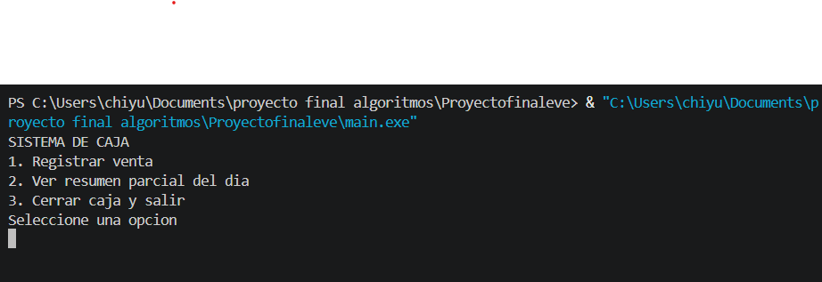
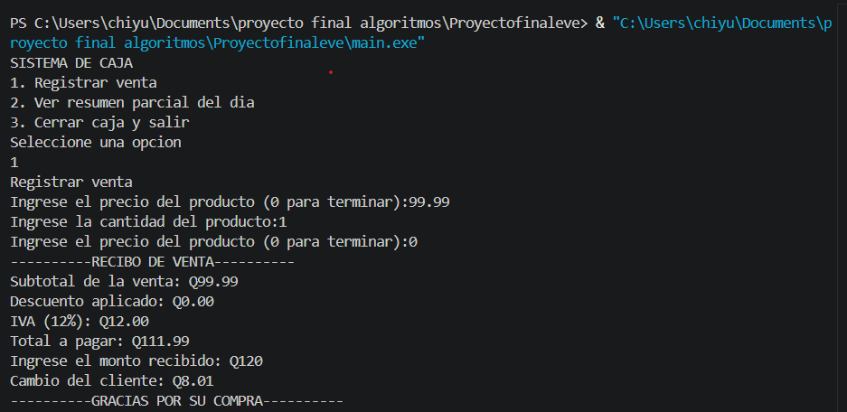
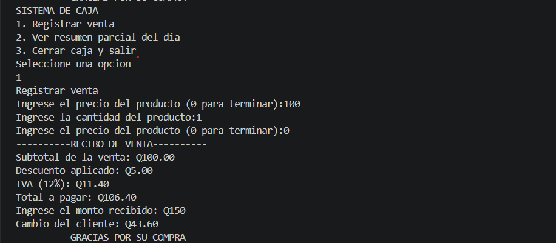
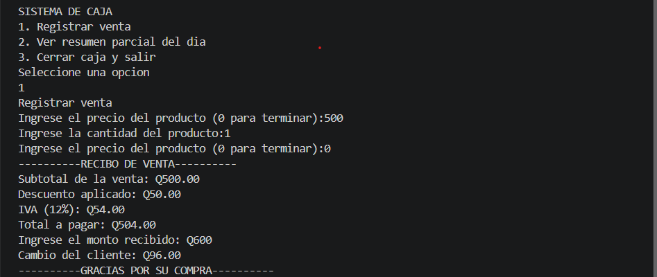
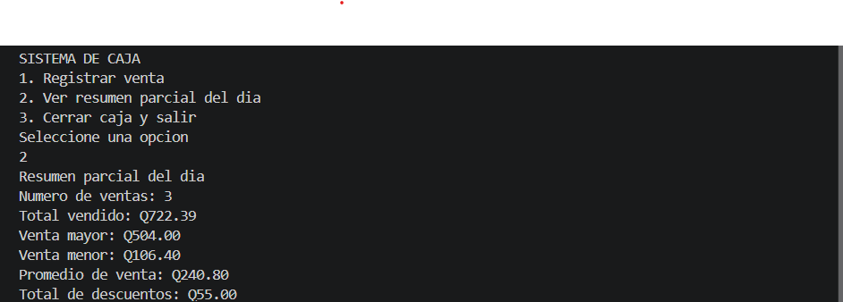
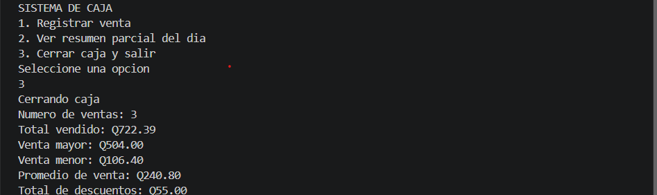
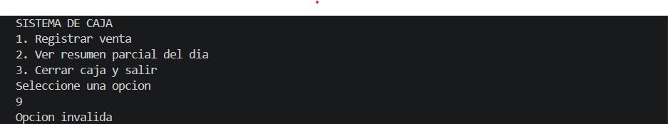
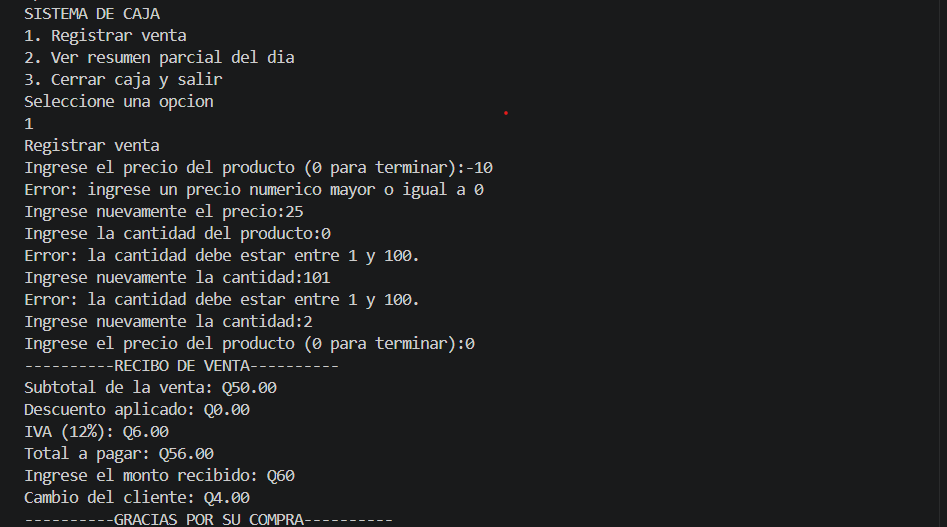
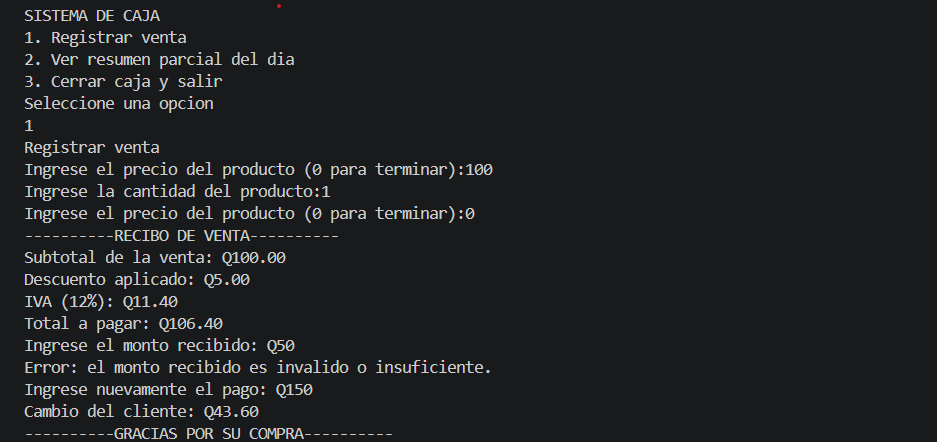
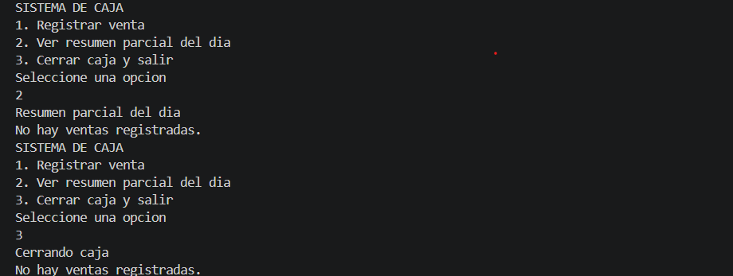

# Sistema de caja para una tienda

## Descripcion del proyecto

Este proyecto consiste en un sistema de caja desarrollado rn C++ para simular las ventas de una tienda. Permite registrar productos, calcular descuentos, IVA del 12%, total a pagar y cambio del cliente.
Tambie incluye validaciones para evitar datos incorectos y un resumen del dia que muestra el numero de ventas, el total vendido, la venta mayor, la venta menor, el promedio y los descuentos otorgados. 

## Lenguaje utilizado
- C++
- Editor: visual studio code
- Control de version: Git y GitHub

## Como compilar y ejecutar el programa
1. abrir el proyecto en visual studio code
2. abrir la terminal y ubicarse en la carpeta donde esta main.cpp
3. compilar el programa con el siguiente comando:
´´´bash
 g++ main.cpp -o main.exe
 ´´´
4. ejecutar el programa con:
´´´powershell
.\main.exe
´´´
5. seleccionar una opcion del menu para utilizar el sistema de caja

## Caso de prueba

Durante el desarrollo del programa se realizaron pruebas para comprobar los descuentos, las validaciones y el funcionamiento del sistema de caja.

 |Prueba  |Resultados obtenidos|
 |---|---|
 |venta de Q99.99 |sin descuento|
 |venta de Q100 |descuento del 5%|
 |venta de Q500 |descuento del 10%|
 |cantidad 0 |Muestra mensaje de error|
 |cantidad 101 |muestra mensaje de error|
 |precio negativo |solicita nuevamente el precio|
 |opcion 9 |muestra "opcion no valida"|
 |resumen sin venta |muestra "no hay ventas registradas"|
 |pago insuficinte |solicita nuevamente el pago|

 ## capturas de ejecucion

 ### menu principal
 

 ### venta sin descuento
 

 ### descuento del 5%
 

 ### descuento del 10%
 

 ### resumen del dia
 

 ### cierre de caja
 

 ### opcion invalida
 

 ### validaciones de precio y cantidad
 

 ### pago insuficiente 
 

 ### resumen sin venta
 

 ## uso de inteligencia articial 

 Durante el desarrollo de este proyecto utilize chatGPT como herramienta de apoyo para comprender conceptos de programacion y resolver dudas que surgieron al trabajar en el sistema de caja.

 ### Hito 1: menu y validacion

 **Que le pregunte a la IA:**
 -para que sirve el ciclo while y como se utiliza.
 -cual es la diferencia entre el while y do-while.
 -como funciona la estructura switch
 -como hacer que un menu se repita hasta seleccionar la opcion salir
 -como identificar errores cuando el programa no compila.

 **Sugerencias que acepte:**
 acepte las explicaciones sobre el uso de do-while y switch para organizar el menu. tambien segui las recomendaciones para configurar el archivo .gitignore y evitar subir archivos ejecutables al repositorio.

 **Que sugerencias rechaze:**
 En esta etapa no recuerdo haber rechazado una sugerencia especifica. fui revisando las explicaciones y comprobando el funcionamiento del programa antes de continuar.

 **Porque utilize IA:**
 porque necesitaba comprender mejor las estructuras de control de C++ y aprender a utilizar las herramientas de desarrollo y control de versiones.

 ### Hito 2: ventas, descuentos y resumen

 **Que le pregunte a la IA:**
 pregunte como funciona las condiciones if y else, como aplicar porcentajes para calcular descuentos e IVA y como obtener el cambio del cliente.
 Tambien consulte para que sirven los contadores y acumuladores, como utilizar cin.fail() para validar entradas y como evitar errores en los calculos del resumen.

 **Que sugerencias acepte:**
 acepte utilizar condiciones para aplicar descuentos del 5% y 10%, acumuladores para registrar los totales de venta y validaciones para solicitar nuevamente los datos incorrectos.
 Tambien recibi orientacion para corregir partes del codigo que no funcionaban correctamente

 **Que sugerencias rechaze:**
 algunas sugerencias iniciales para validar los datos no dieron resultado esperados. por eso fue necesario modificar y realizar nuevas pruebas hasta corregir los errores.

 **Porque utilice IA:**
 porque tenia dudas sobre algunos calculos y validaciones del programa. las explicaciones y los ejemplos me ayudaron a comprender los procedimientos y revisar el funcionamiento del sistema.

 ### Hito 3: pruebas finales y documentacion

 **Que le pregunte a la IA:**
 consulte como realizar las pruebas finales del sistema de caja, como comprobar las valiaciones y como organizar las capturas de ejecucion.
 Tambien pregunte como elaborar el archivo README.md, como utilizar Markdown y como agregar imagenes y documentar los resultados en el README.

 **Que sugerencias acepte:**
 acepte realizar pruebas con diferentes cantidades, precios, descuentos, pagos insuficientes y opciones incorrectas.
 Tambien segui las indicaciones para crear la carpeta capturas, organizar las imagenes y documentar los resultados en el README.

 **Que sugerencias rechace:**
en ete hito no identidfique una sugerencia que tuviera que rechazar completamente. revise las indicaciones y ajuste algunos detalles de la documentacion para organizarla correctamente.

**Porque utilize IA:**
porque queria comprobar que el programa cumpliera con los requisitos del proyecto final y aprender a presentar correctamente las evidencias de su funcionamiento.

## video de demostracion 
En el siguiente video se muestra el funcionamiento del sistema de caja para una tienda, desarrollada en C++.
[ver video del proyecto final en youtube](https://youtu.be/QZ8FrJ66484)

